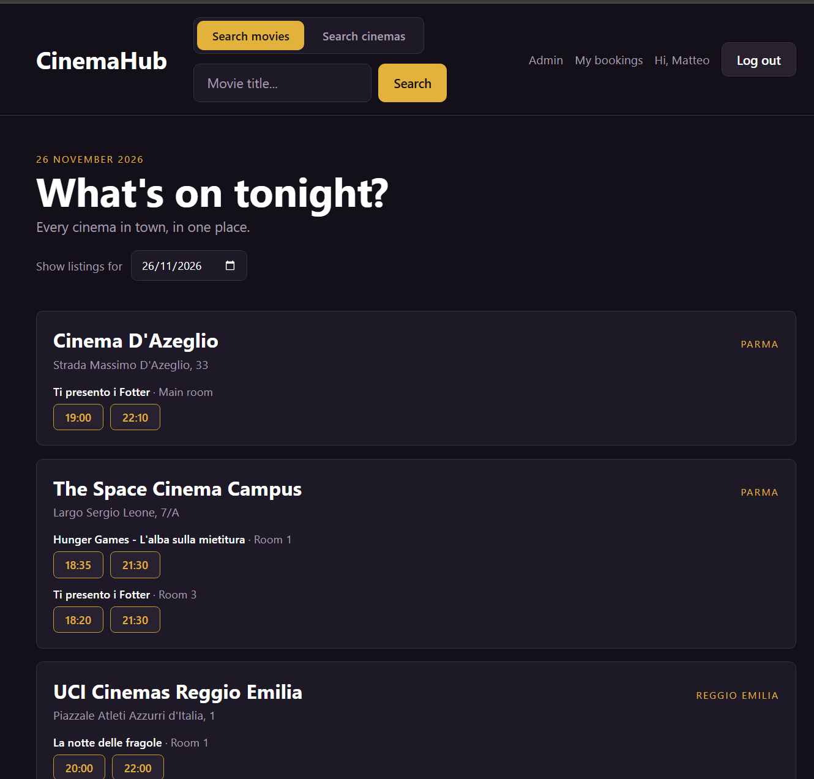
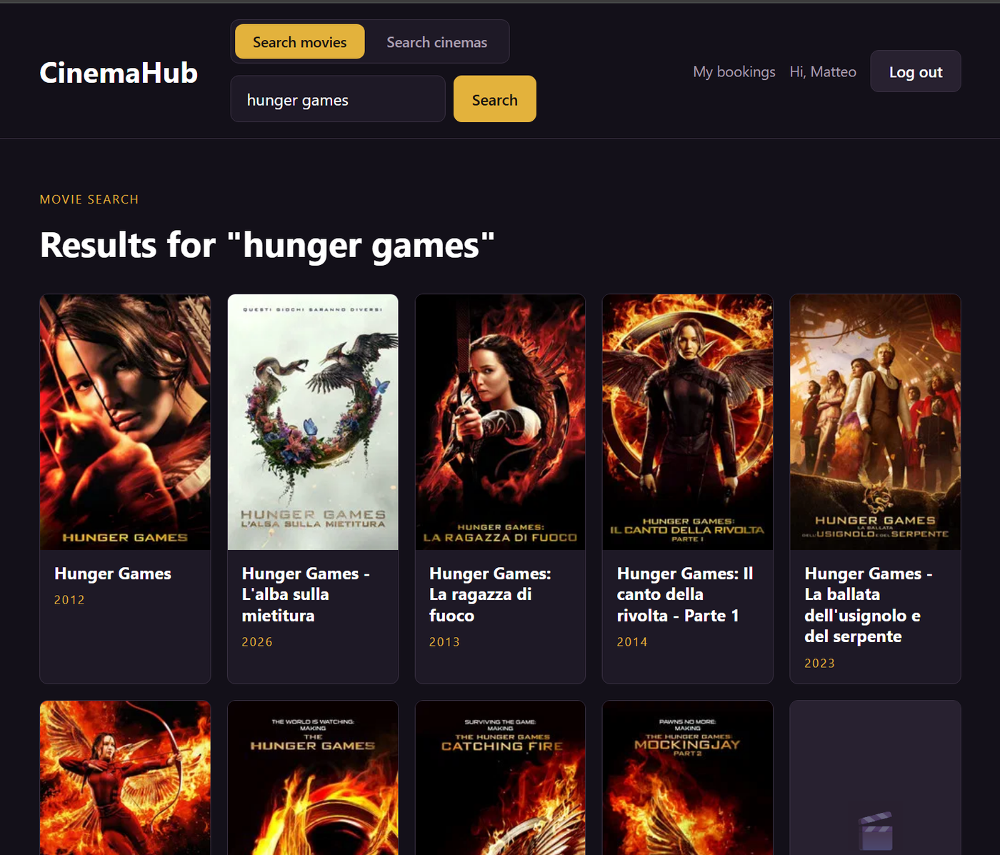
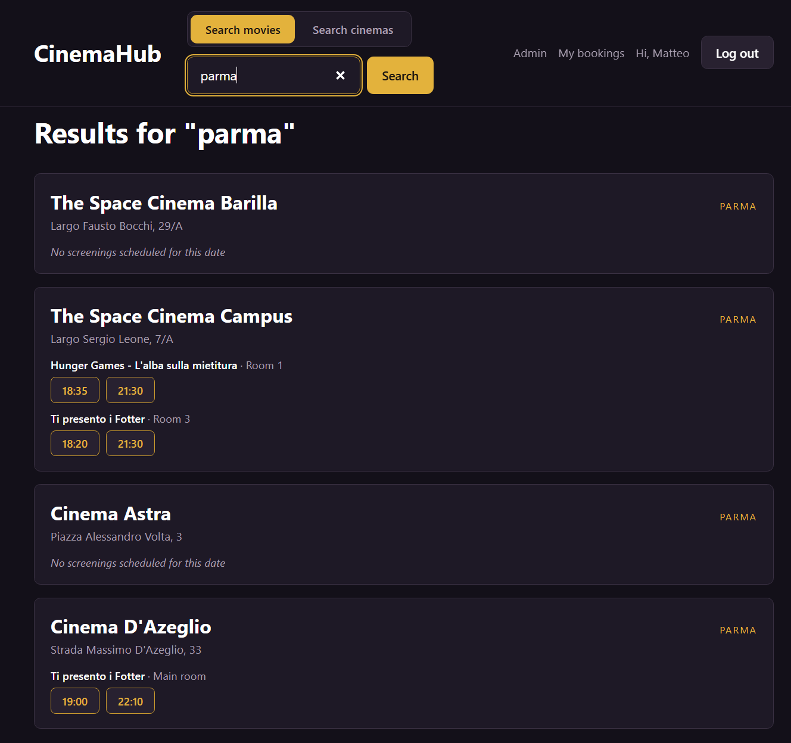
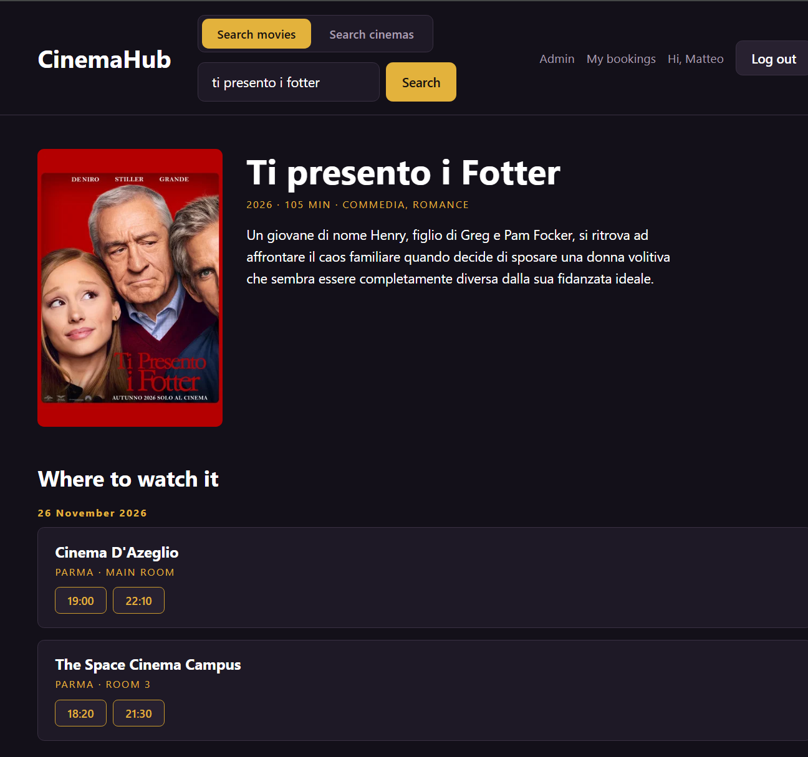
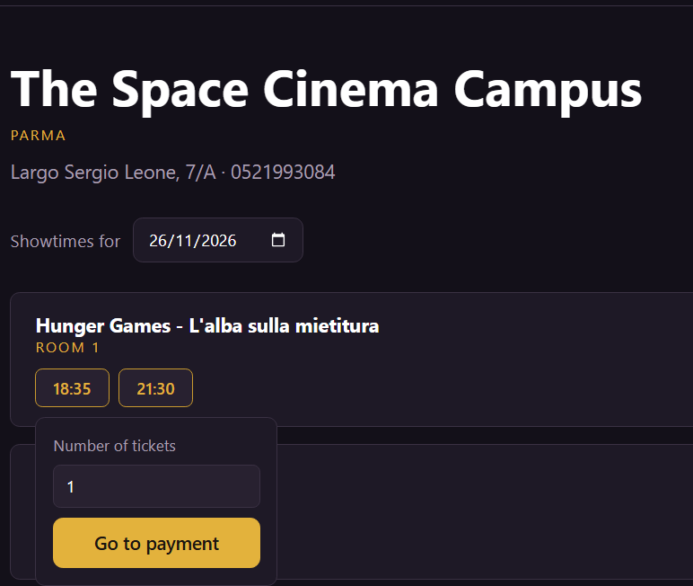
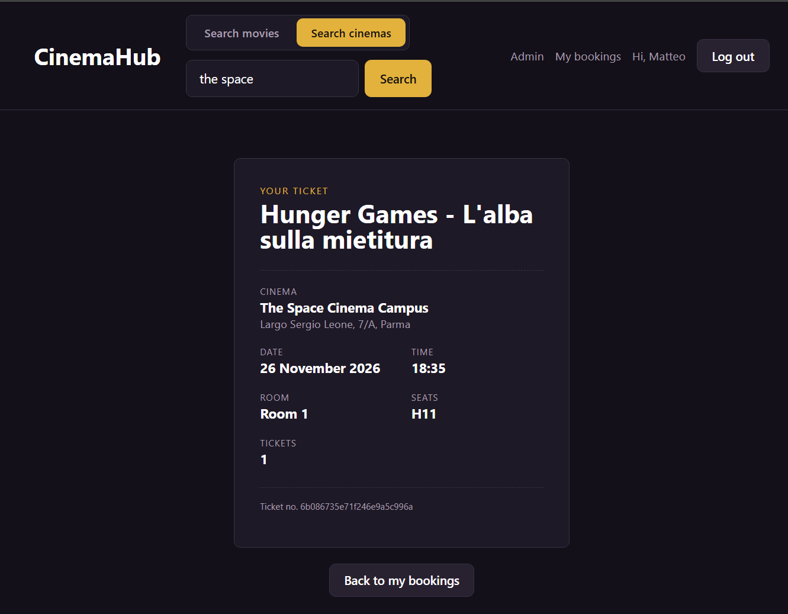
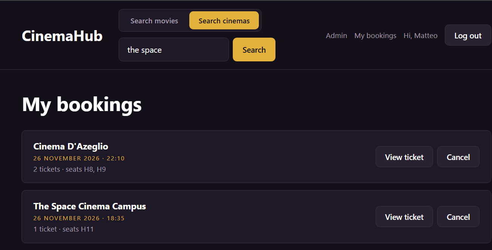
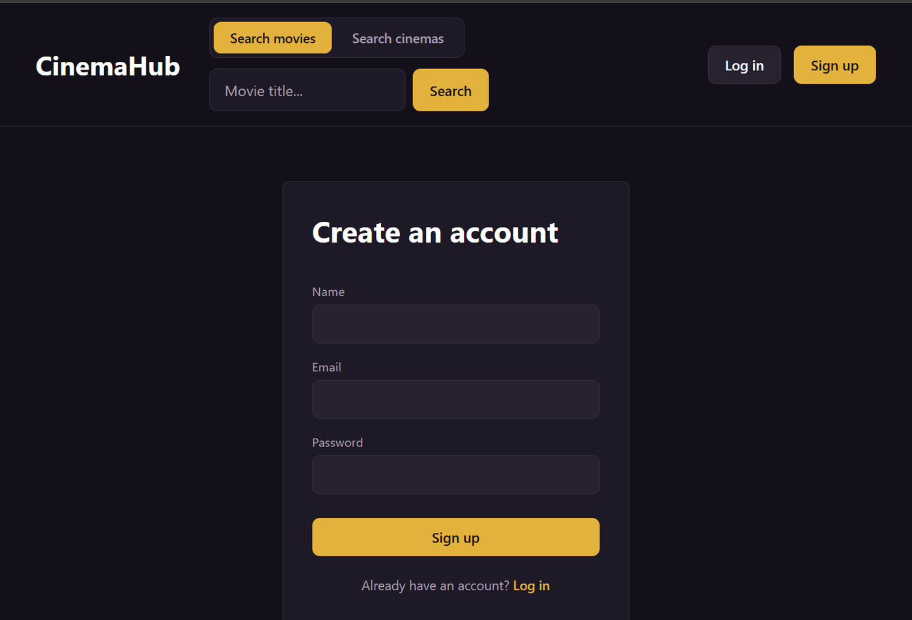
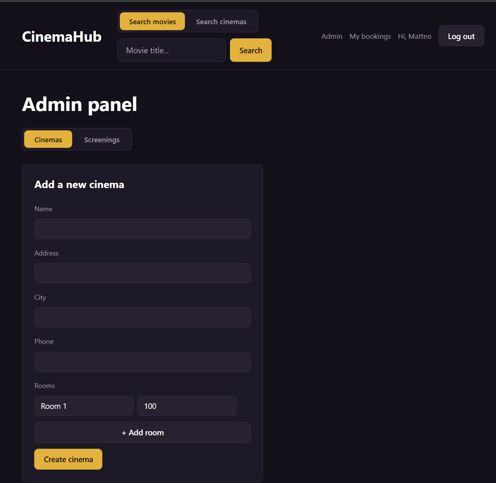
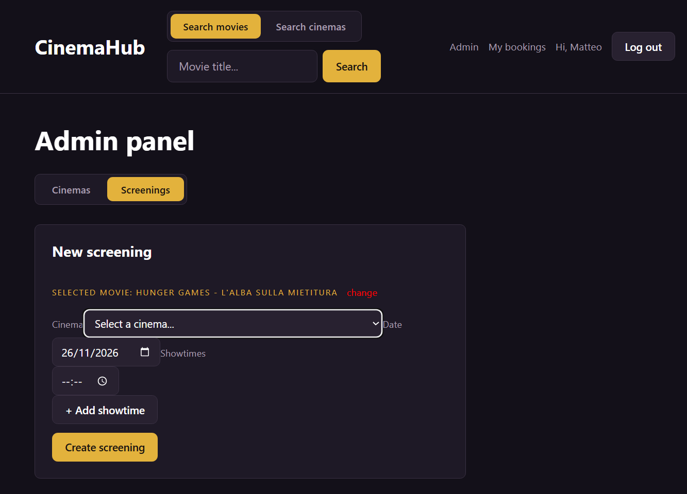

# CinemaHub 🎬

Full-stack web application to browse the showtimes of cinemas in the provinces of **Parma** and **Reggio Emilia** (Italy), search for movies and **book tickets online** (with a simulated payment).

Project for the *Internet Technologies* course – University of Parma, academic year 2025/2026.



## Features

- **Cinema showtimes** with date filter
- **Search** for movies and cinemas, with screenings grouped by cinema or by date
- **Movie details** (title, poster, plot) fetched in real time from [TMDB](https://www.themoviedb.org/)
- **Sign up and login** with JSON Web Token–based sessions
- **Booking** for a screening, choosing the number of tickets, with **automatic seat assignment**
- **Simulated payment** (no real charge)
- **My bookings**: view tickets and cancel a booking if the screening hasn't started yet
- **Admin panel** to manage cinemas and screenings (admin users only)

## Tech stack

| Layer | Technologies |
|---|---|
| Frontend | React, Vite, React Router, Axios, Context API |
| Backend | Node.js, Express, versioned RESTful API (`/api/v1`) |
| Database | MongoDB (Atlas), Mongoose |
| Security | JWT, passwords hashed with bcrypt, user/admin roles |
| External services | The Movie Database (TMDB) API |

## Architecture

```
React (Vite)  ──HTTP/JSON──▶  Node.js + Express  ──▶  MongoDB (Mongoose)
                                      │
                                      └──▶  TMDB API
```

The client never talks directly to the database or to TMDB: every request goes through the backend, so the TMDB key and the business logic stay on the server.

The database has 4 collections linked through `ObjectId` references: `users`, `cinemas`, `screenings`, `reservations`.

### Main API endpoints

| Resource | Endpoint | Access |
|---|---|---|
| Auth | `POST /auth/register`, `POST /auth/login` | Public |
| Cinemas | `GET /cinemas`, `GET /cinemas/:id` · `POST/PUT/DELETE /cinemas` | Public read · admin write |
| Screenings | `GET /screenings` · `POST/PUT/DELETE /screenings` | Public read · admin write |
| Movies | `GET /films/search`, `GET /films/:tmdbId` | Public (TMDB proxy) |
| Reservations | `GET /reservations/me`, `POST /reservations`, `GET/DELETE /reservations/:id` | Authenticated user |

All endpoints are prefixed with `/api/v1`.

## Running locally

**Requirements:** Node.js 20+, a MongoDB database (e.g. a free cluster on [MongoDB Atlas](https://www.mongodb.com/atlas)) and a [TMDB](https://www.themoviedb.org/settings/api) API key.

### 1. Backend

```bash
cd backend
npm install
cp .env.example .env      # then fill in your values in .env
npm run seed              # (optional) populates the database with cinemas in Parma and Reggio Emilia
                          # warning: deletes existing cinemas and screenings
npm run dev               # starts the server on http://localhost:5000
```

### 2. Frontend

```bash
cd frontend
npm install
npm run dev               # opens the app on http://localhost:5173
```

### 3. Create an admin user

Sign up from the app, then promote your user to admin:

```bash
cd backend
npm run promote-admin -- your@email.com
```

## Screenshots

### Browsing

| Home – today's showtimes | Movie search (TMDB) |
|---|---|
|  |  |

| Cinema search | Movie details and where to watch it |
|---|---|
|  |  |

### Booking

| Choosing tickets | Ticket |
|---|---|
|  |  |

| My bookings | Sign up |
|---|---|
|  |  |

### Admin panel

| Add a cinema | Add a screening |
|---|---|
|  |  |

## Author

- **Matteo Robustelli**

